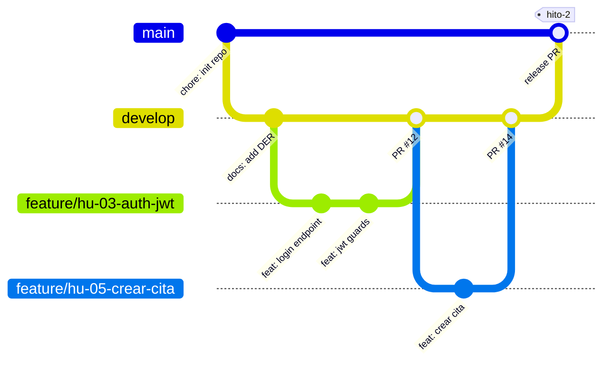

# GesTaller

> Plataforma SaaS de gestión de citas y órdenes de reparación para talleres mecánicos.


-lightgrey)

> **Repositorio de referencia (Gold Standard)** del módulo PIDW2. Muestra la estructura, la documentación y las convenciones mínimas exigidas en los Hitos 1 y 2. **No contiene la lógica de negocio completa** a propósito: el objetivo es que aprendas a *leer* una arquitectura, no a copiarla. Cada archivo lleva bloques «NOTAS DE ARQUITECTURA PARA EL ALUMNO» que explican el porqué de cada decisión.

## Ficha técnica

| Campo       | Valor                                                                 |
|-------------|-----------------------------------------------------------------------|
| Ciclo       | Desarrollo de Aplicaciones Web (2º DAW, modalidad virtual)            |
| Módulo      | Proyecto Intermodular (PIDW2)                                         |
| Autor       | Alumno Ejemplo (ficticio)                                             |
| Tutor       | Pablo Lera Menéndez                                                   |
| Centro      | CIFP Avilés — Curso 2026/2027                                         |
| Tablero     | [GitHub Projects — GesTaller (enlace simulado)](https://github.com/users/alumno-ejemplo/projects/1) |
| Documentos  | [Anteproyecto](Anteproyecto.md) · [DER](docs/der.md) · [Contrato API REST](docs/contrato_api_rest.md) · [Pruebas de API](docs/api/README.md) |

## Resumen ejecutivo

GesTaller digitaliza el ciclo completo de un taller mecánico independiente: la reserva de citas, la apertura de la orden de reparación, el registro de servicios y piezas empleados y el seguimiento del estado por parte del cliente.

La propuesta de valor es triple. El cliente consulta el estado de su vehículo sin llamar al taller. El mecánico registra el trabajo realizado desde cualquier dispositivo. El administrador obtiene trazabilidad económica, ya que el precio de cada línea de la orden se congela en el momento de su creación.

## Roles y permisos (RBAC)

| Funcionalidad                          | Público (anónimo) | Administrador | Mecánico/Técnico | Cliente/Socio |
|----------------------------------------|:-----------------:|:-------------:|:----------------:|:-------------:|
| Consultar catálogo de servicios        | 👁️ lectura        | ✅            | 👁️ lectura       | 👁️ lectura    |
| Registrarse / iniciar sesión           | ✅                | —             | —                | —             |
| Gestionar usuarios y roles             | ❌                | ✅            | ❌               | ❌            |
| Gestionar catálogo de servicios (CRUD) | ❌                | ✅            | ❌               | ❌            |
| Ver agenda completa de citas           | ❌                | ✅            | ✅ (propias)     | ❌            |
| Solicitar / cancelar cita              | ❌                | ✅            | ❌               | ✅ (propias)  |
| Crear y actualizar órdenes             | ❌                | ✅            | ✅ (asignadas)   | ❌            |
| Consultar estado de órdenes            | ❌                | ✅            | ✅               | ✅ (propias)  |
| Registrar vehículos                    | ❌                | ✅            | ✅               | ✅ (propios)  |

> El Hito 1 exige diferenciar **Público, Usuario y Administrador**. Aquí el rol «Usuario» se concreta en dos perfiles del negocio (Mecánico y Cliente). Si tu dominio solo tiene un perfil de usuario registrado, usa solo tres columnas: no inventes roles para parecer más complejo.

## Pila tecnológica y justificación

| Capa          | Tecnología              | Justificación                                                                 |
|---------------|-------------------------|-------------------------------------------------------------------------------|
| Backend       | Node.js 20 + Express    | Un único lenguaje en toda la pila; ecosistema maduro; arquitectura en capas explícita. |
| Frontend      | React 18 + Vite         | SPA desacoplada del backend; arranque rápido; componentes reutilizables.      |
| Base de datos | MySQL 8 + Knex (migraciones) | Modelo transaccional con integridad referencial normalizado hasta 3FN; el esquema se versiona con migraciones, nunca con volcados `.sql`. |
| Autenticación | JWT + bcrypt            | API sin estado; contraseñas almacenadas únicamente como hash.                 |
| Contrato      | REST + JSON             | Errores en formato RFC 9457 documentados en `docs/contrato_api_rest.md`.      |

## Estructura del repositorio

```text
daw-proyecto-referencia-gold/
├── .github/
│   ├── ISSUE_TEMPLATE/user_story.md   # historia de usuario + criterios de aceptación
│   └── PULL_REQUEST_TEMPLATE.md       # PR con "Closes #N" y checklist
├── docs/
│   ├── der.md                         # DER Mermaid + 3FN + diccionario de datos
│   ├── contrato_api_rest.md           # formato de respuestas y códigos HTTP
│   └── api/                           # evidencias de pruebas (OpenAPI / Postman)
├── backend/                           # API en capas (ver backend/src)
├── frontend/                          # SPA desacoplada
├── Anteproyecto.md                    # entregable del Hito 1
├── .env.example                       # contrato de entorno (sin secretos)
├── .gitignore
└── README.md
```

## Puesta en marcha en local

Requisitos: Node.js ≥ 20, MySQL 8 y Git. Crea antes en MySQL una base de datos vacía y un usuario de aplicación con permisos solo sobre ella (nunca `root`).

```bash
# 1. Clonar el repositorio
git clone https://github.com/PabloLera92/daw-proyecto-referencia-gold.git
cd daw-proyecto-referencia-gold

# 2. Trabajar sobre la rama de integración
git checkout develop

# 3. Configurar variables de entorno (valores propios, nunca al repo)
cp .env.example .env     # edita DB_PASSWORD y JWT_SECRET con valores propios
openssl rand -base64 32  # úsalo como JWT_SECRET

# 4. Instalar dependencias
cd backend && npm install
cd ../frontend && npm install

# 5. Reconstruir la base de datos desde cero (migraciones + seeders)
cd ../backend
npm run db:reset

# 6. Arrancar (dos terminales)
npm run dev                  # backend  -> http://localhost:3000/api/v1/health
cd ../frontend && npm run dev   # frontend -> http://localhost:5173
```

> Un único `.env` en la raíz alimenta backend (`dotenv`) y frontend (`envDir` de Vite). Solo las variables con prefijo `VITE_` llegan al navegador.
>
> **Comprueba tu propio README:** clona tu repo en una carpeta vacía y sigue tus pasos al pie de la letra. Si algo falla, tu guía de arranque está incompleta. Un evaluador no te va a preguntar cómo se arranca.

## Estrategia de ramas (Gitflow simplificado)



| Rama          | Función                                   | Reglas                                            |
|---------------|-------------------------------------------|---------------------------------------------------|
| `main`        | Código entregado y desplegable            | **Inmutable**: solo recibe PR desde `develop` al cerrar un hito. Protegida (sin push directo ni force-push). Los tags de entrega se crean aquí. |
| `develop`     | Integración del trabajo del sprint        | Recibe `feature/*` mediante Pull Request.         |
| `feature/*`   | Una historia de usuario = una rama        | Nombre: `feature/hu-<nº>-<verbo-objeto>` (`feature/hu-03-auth-jwt`). Nace de `develop` y **se borra tras el merge**. |

**Tags de entrega:** `hito-1`, `hito-2`, `v0.3.0-mvp`… sobre `main` (`git tag -a hito-2 -m "..." && git push origin hito-2`).
**Commits:** [Conventional Commits](https://www.conventionalcommits.org/) (`feat:`, `fix:`, `docs:`, `refactor:`, `chore:`, `test:`). El tipo siempre en inglés; la descripción, en infinitivo (español) o imperativo (inglés), sin mezclar idiomas. El Hito 2 exige **≥ 80 %**.

### Comandos diarios de Git

Antes de ejecutar un comando, **predice** qué va a pasar; después compruébalo con `git status` o `git log --oneline --graph --all`.

| Qué quiero hacer                                  | Comando                                                | Qué debo comprobar                                  |
|---------------------------------------------------|--------------------------------------------------------|-----------------------------------------------------|
| Empezar el día con `develop` actualizado          | `git switch develop && git pull`                       | «Fast-forward» o «Already up to date»               |
| Crear la rama de una historia                     | `git switch -c feature/hu-05-crear-cita`               | `git status` muestra la rama nueva                  |
| Ver qué he cambiado                               | `git status` · `git diff` · `git diff --staged`        | Distingue cambios sin preparar y preparados         |
| Preparar y confirmar un cambio lógico             | `git add <ficheros>` · `git commit -m "feat(citas): crear cita"` | Un commit = un cambio. Nunca `git add .` a ciegas   |
| Sacar un fichero del área de preparación          | `git restore --staged <fichero>`                       | El fichero no se toca; solo deja de estar preparado |
| Subir mi rama por primera vez                     | `git push -u origin feature/hu-05-crear-cita`          | Aparece la rama en GitHub                           |
| Abrir el Pull Request hacia `develop`             | `gh pr create --base develop` (o desde la web)         | Descripción con `Closes #<issue>`                   |
| Traer a mi rama lo último de `develop`            | `git switch develop && git pull && git switch -` → `git merge develop` | `git pull` solo actualiza `develop`, no tu rama     |
| Borrar la rama tras fusionar el PR                | `git branch -d feature/hu-05-crear-cita`               | La rama efímera muere; la historia queda en `develop` |
| Cerrar un hito                                    | PR `develop` → `main` y después `git tag -a hito-2 -m "..."` | El tag apunta a `main`                              |
| ¿Se coló un `.env` en el historial?               | `git log --all --oneline -- .env`                      | Sin salida = limpio                                 |
| Me equivoqué y subí un secreto                    | Ver «Comandos de emergencia» en [`.gitignore`](.gitignore) | **Primero rotar el secreto**                        |

> **Prohibido:** `git push --force` sobre `develop` o `main`, y trabajar directamente sobre `main`. Si un `push` a `main` es rechazado, es el comportamiento correcto: crea una rama y abre un PR.

---

## 📘 GUÍA METODOLÓGICA: CÓMO REPLICAR ESTA ESTRUCTURA EN TU ANTEPROYECTO

Este repositorio es un **espejo**, no una plantilla para rellenar. Lo que debes copiar es el **criterio**; lo que nunca debes copiar es el **contenido**. Sigue estos pasos en orden y, en cada uno, hazte la pregunta de control.

### Paso 0 · Parte de tu dominio, no del mío
Escribe en una frase qué problema real resuelve **tu** aplicación y para quién. Si la frase solo funciona cambiando «taller» por «gimnasio», no es tuya todavía.
*Pregunta de control: ¿podría explicarlo en 30 segundos a alguien que no sabe informática?*

### Paso 1 · `.gitignore` y `.env.example` antes del primer commit
1. Crea el `.gitignore` **adaptado a tu stack** (Laravel ignora `/vendor`; Python, `.venv/`).
2. Escribe al lado de cada regla qué protege y por qué. Si no sabes justificarla, investígala o bórrala.
3. Haz la **auditoría de tu `.env.example`**: recorre tu código, lista las variables que lee y documenta cada una (propósito, formato, advertencia).
4. Comprueba con `git check-ignore -v .env` y `git ls-files` que `.env` no se sigue y `.env.example` sí.
*Pregunta de control: ¿podría hacer público mi repo ahora mismo sin comprometer ninguna credencial?*

### Paso 2 · README profesional (en tercera persona y con datos concretos)
- **Resumen ejecutivo:** presente técnico, tercera persona, 100-150 palabras, con *cifras o hechos de tu dominio* (quién usa qué y qué cambia). Evita «revolucionar», «soluciones innovadoras», «plataforma integral».
- **RBAC:** deriva la matriz de **tus casos de uso**, no al revés. Mínimo Público, Usuario y Admin.
- **Stack:** una opción por capa y **una razón ligada a tu proyecto** («Express porque ya domino JS en DWEC y comparto lenguaje con el front»), no «porque es muy popular».
- **Guía de arranque:** pruébala en una carpeta limpia (ver nota en «Puesta en marcha»).
*Pregunta de control: ¿un desconocido arranca mi proyecto en 5 minutos sin escribirme?*

### Paso 3 · Modelo de datos (Hito 2): de los casos de uso a las tablas
1. Subraya los **sustantivos** de tus casos de uso: son candidatas a entidad.
2. Busca el **flujo transaccional** (alguien «pide», «reserva», «contrata»…): ahí vive tu **M:N**.
3. Pregunta: *¿qué hay que recordar sobre cada par?* (cantidad, precio pactado, fecha, estado…). Esos son los **atributos de la tabla intermedia**. Si no hay ninguno, no tienes una M:N de negocio.
4. Congela lo que debe ser histórico (precios) y **no persistas lo que se calcula** (totales).
5. Revisa 1FN, 2FN y 3FN tabla a tabla y escribe la justificación (ver `docs/der.md`).
*Pregunta de control: si mañana cambia un precio en el catálogo, ¿se alteran mis facturas pasadas?*

### Paso 4 · API y arquitectura en capas
Define primero el **contrato** (`docs/contrato_api_rest.md`) y después el código. Cada archivo cumple **una** responsabilidad: rutas cablean, controladores traducen HTTP, servicios deciden, modelos hablan con la BD, middlewares protegen. Si un controlador pasa de ~30 líneas por handler, la lógica está en el sitio equivocado.
*Pregunta de control: ¿dónde está el SQL de mi proyecto? (Solo debe haber una respuesta: en los modelos.)*

### Paso 5 · Trazabilidad ágil
Cada historia es un *issue* con la plantilla `user_story.md`: rol real de tu RBAC, criterios de aceptación **comprobables** (Dado/Cuando/Entonces, con errores y permisos) y etiquetas. Una historia = una rama = un PR con `Closes #N`. Máximo 1-2 tarjetas en `In Progress`.
*Pregunta de control: ¿cada criterio de aceptación se puede convertir en una prueba?*

### Qué NO copiar de este repositorio
| No copies…                                         | Porque…                                                              |
|----------------------------------------------------|----------------------------------------------------------------------|
| Nombres de entidades, atributos y roles de GesTaller | Tu dominio es otro; un DER de taller en un proyecto de otro sector delata la copia |
| Frases de los README, comentarios o mensajes de error | La defensa oral te pedirá explicarlas con tus palabras               |
| Los `TODO(alumno)` sin resolver                    | Son marcas deliberadas: una entrega con ellos intactos es una alerta |
| El nivel de detalle de los comentarios didácticos  | En tu código, comenta el **porqué** de decisiones no obvias, no el obvio |

### Cómo evitar la sobreingeniería y el texto hueco generado por IA

| Señal de sobreingeniería                              | Alternativa proporcionada                                            |
|-------------------------------------------------------|----------------------------------------------------------------------|
| Microservicios, colas o Kubernetes en un MVP de dos meses | Un monolito en capas bien separado                                |
| Un patrón (CQRS, DDD, hexagonal) que no sabes defender | Las cuatro capas de este repo y nada más                           |
| 20 entidades «por si acaso»                           | 5-7 tablas de negocio con un flujo transaccional completo            |
| IA o visión artificial como núcleo del MVP (causa de insuficiente en el Hito 1) | Un flujo CRUD + transacción M:N que funcione en producción |

| Señal de texto hueco de IA                            | Cómo se arregla                                                      |
|-------------------------------------------------------|----------------------------------------------------------------------|
| «En el mundo actual…», «sin duda», «robusta y escalable» | Sustituye cada adjetivo por un dato o un hecho verificable        |
| Párrafos que valen para cualquier proyecto            | Si cambia el dominio y la frase sigue valiendo, bórrala              |
| Justificar el stack con «es muy popular y potente»    | Razón concreta ligada a tu proyecto y a tus conocimientos            |
| Código o comentarios que no sabes explicar            | Defínelo con tus palabras o elimínalo: se evalúa en la defensa       |

**Regla de oro:** cada frase de tu documentación y cada línea de tu código debe poder defenderse en voz alta cuando el tutor pregunte «¿por qué?».

---

## Mapa de requisitos oficiales

| Requisito (Hitos 1 y 2)                               | Dónde se demuestra en este repo                  |
|-------------------------------------------------------|--------------------------------------------------|
| `.gitignore` exhaustivo, sin secretos ni dependencias | [`.gitignore`](.gitignore)                       |
| `.env.example` documentado                            | [`.env.example`](.env.example)                   |
| README con badges, ficha, RBAC, stack y arranque      | Este archivo                                     |
| `Anteproyecto.md` (Hito 1)                            | [`Anteproyecto.md`](Anteproyecto.md)             |
| DER Mermaid ≥ 5 tablas de negocio + M:N con atributos + 3FN | [`docs/der.md`](docs/der.md)               |
| Contrato REST, códigos HTTP y RFC 9457                | [`docs/contrato_api_rest.md`](docs/contrato_api_rest.md) |
| Evidencias de pruebas (OpenAPI/Postman)               | [`docs/api/`](docs/api/README.md)                |
| Historias de usuario y PR trazables                   | [`.github/`](.github/ISSUE_TEMPLATE/user_story.md) |
| Arquitectura en capas                                 | [`backend/src/`](backend/src)                    |
| Migraciones y seeders por código, comando único       | [`backend/database/`](backend/database/migrations/README.md) |

## Licencia

Uso académico — CIFP Avilés, curso 2026/2027. Proyecto ficticio de referencia.
