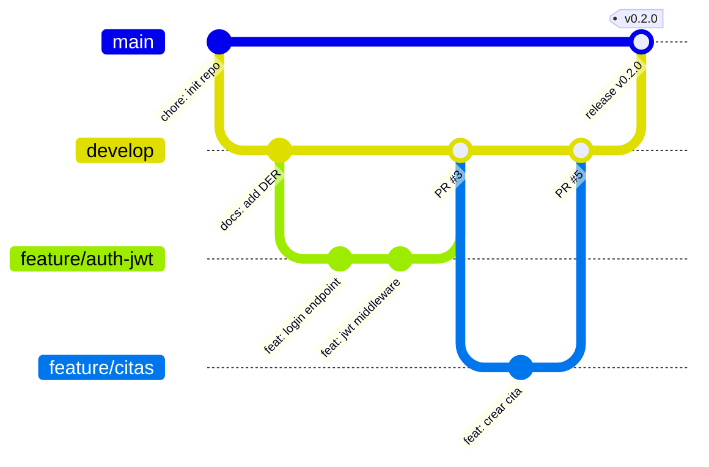

# GesTaller

> Plataforma SaaS de gestión de citas y órdenes de reparación para talleres mecánicos.


-lightgrey)

> **Repositorio de referencia (Gold Standard)** del módulo PIDW2. Muestra la estructura, la documentación y las convenciones mínimas exigidas en el Hito 2. **No contiene la lógica de negocio completa** a propósito: el objetivo es que aprendas a *leer* una arquitectura, no a copiarla.

## Ficha técnica

| Campo       | Valor                                                                 |
|-------------|-----------------------------------------------------------------------|
| Ciclo       | Desarrollo de Aplicaciones Web (2º DAW, modalidad virtual)            |
| Módulo      | Proyecto de Desarrollo de Aplicaciones Web (PIDW2)                    |
| Autor       | Alumno Ejemplo (ficticio)                                             |
| Tutor       | Pablo Lera Menéndez                                                   |
| Centro      | CIFP Avilés — Curso 2026/2027                                         |
| Tablero     | [GitHub Projects — GesTaller (enlace simulado)](https://github.com/users/alumno-ejemplo/projects/1) |
| Documentos  | [DER](docs/der.md) · [Contrato API REST](docs/contrato_api_rest.md)   |

## Resumen ejecutivo

GesTaller digitaliza el ciclo completo de un taller mecánico independiente: la reserva de citas, la apertura de la orden de reparación, el registro de servicios y piezas empleados y el seguimiento del estado por parte del cliente.

La propuesta de valor es triple. El cliente consulta el estado de su vehículo sin llamar al taller. El mecánico registra el trabajo realizado desde cualquier dispositivo. El administrador obtiene trazabilidad económica, ya que el precio de cada línea de la orden se congela en el momento de su creación.

## Roles y permisos (RBAC)

| Funcionalidad                          | Administrador | Mecánico/Técnico | Cliente/Socio |
|----------------------------------------|:-------------:|:----------------:|:-------------:|
| Gestionar usuarios y roles             | ✅            | ❌               | ❌            |
| Gestionar catálogo de servicios        | ✅            | 👁️ lectura       | 👁️ lectura    |
| Ver agenda completa de citas           | ✅            | ✅ (propias)     | ❌            |
| Solicitar / cancelar cita              | ✅            | ❌               | ✅ (propias)  |
| Crear y actualizar órdenes             | ✅            | ✅ (asignadas)   | ❌            |
| Consultar estado de órdenes            | ✅            | ✅               | ✅ (propias)  |
| Registrar vehículos                    | ✅            | ✅               | ✅ (propios)  |

## Pila tecnológica y justificación

| Capa          | Tecnología              | Justificación                                                                 |
|---------------|-------------------------|-------------------------------------------------------------------------------|
| Backend       | Node.js 20 + Express    | Un único lenguaje en toda la pila; ecosistema maduro; arquitectura en capas explícita. |
| Frontend      | React 18 + Vite         | SPA desacoplada del backend; arranque rápido; componentes reutilizables.      |
| Base de datos | MySQL 8 (relacional)    | Modelo transaccional con integridad referencial; normalizado hasta 3FN.       |
| Autenticación | JWT + bcrypt            | API sin estado; contraseñas almacenadas únicamente como hash.                 |
| Contrato      | REST + JSON             | Formato de respuesta uniforme documentado en `docs/contrato_api_rest.md`.     |

## Puesta en marcha en local

Requisitos: Node.js ≥ 20, MySQL 8 y Git.

```bash
# 1. Clonar el repositorio
git clone https://github.com/alumno-ejemplo/daw-proyecto-referencia-gold.git
cd daw-proyecto-referencia-gold

# 2. Trabajar sobre la rama de integración
git checkout develop

# 3. Configurar variables de entorno (valores propios, nunca al repo)
cp .env.example .env     # edita DB_PASSWORD y JWT_SECRET con valores propios

# 4. Instalar dependencias
cd backend && npm install
cd ../frontend && npm install

# 5. Crear la base de datos, migraciones y datos de prueba
cd ../backend
npm run db:migrate
npm run db:seed

# 6. Arrancar (dos terminales)
npm run dev                  # backend  -> http://localhost:3000
cd ../frontend && npm run dev   # frontend -> http://localhost:5173
```

> Un único `.env` en la raíz alimenta backend (`dotenv`) y frontend (`envDir` de Vite). Solo las variables con prefijo `VITE_` llegan al navegador.

## Estrategia de ramas (Gitflow simplificado)



| Rama          | Función                                   | Reglas                                            |
|---------------|-------------------------------------------|---------------------------------------------------|
| `main`        | Código entregable y estable               | Inmutable: solo recibe merges desde `develop` (release). Sin commits directos. |
| `develop`     | Integración continua del trabajo          | Recibe `feature/*` mediante Pull Request.         |
| `feature/*`   | Una historia de usuario = una rama        | Nombre: `feature/<issue>-<descripcion-corta>`. Se borra tras el merge. |

**Commits:** [Conventional Commits](https://www.conventionalcommits.org/) en inglés (`feat:`, `fix:`, `docs:`, `chore:`, `refactor:`, `test:`).

## Licencia

Uso académico — CIFP Avilés, curso 2026/2027. Proyecto ficticio de referencia.
