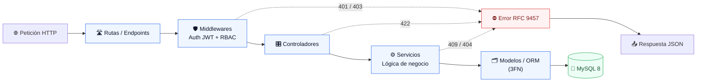
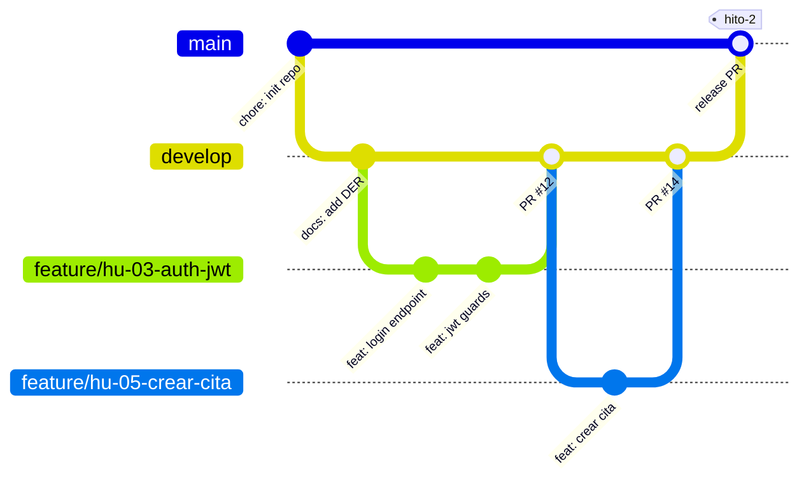

<div align="center">

<table>
  <tr>
    <td align="center" width="100">
      
    </td>
    <td align="left">
      <h1>GESTALLER&nbsp;<code>v0.2.0-sprint2</code></h1>
      <b>PLATAFORMA TRANSACCIONAL DE GESTIÓN MECÁNICA Y CONTROL DE CITAS</b>
      <br />
      <sub><i>CIFP Avilés · 2º DAW Virtual · PIDW2 (Curso 2026/2027)</i></sub>
    </td>
  </tr>
</table>

[](https://github.com/users/PabloLera92/projects/1)
[](https://nodejs.org/)
[](https://expressjs.com/)
[](https://react.dev/)
[](https://www.mysql.com/)
[](https://cifpaviles.sepyc.es/)

<br>

[ [📖 Propuesta de Valor](#propuesta) ] · [ [👥 Roles RBAC](#roles) ] · [ [🏗️ Arquitectura](#arquitectura) ] · [ [🔌 API REST](#api) ] · [ [⚙️ Puesta en Marcha](#arranque) ] · [ [🌿 Gitflow](#gitflow) ] · [ [📊 Roadmap](#roadmap) ]

</div>

<br>

> [!IMPORTANT]
> **Repositorio de referencia (Gold Standard)** · CIFP Avilés — 2º DAW Virtual — Curso 2026/2027 · Módulo PIDW2.
> Tutoría: **Pablo Lera Menéndez**. Tablero Kanban: [GitHub Projects — GesTaller](https://github.com/users/PabloLera92/projects/1) · Backlog: [Issues](https://github.com/PabloLera92/daw-proyecto-referencia-gold/issues).
>
> Muestra la estructura, la documentación y las convenciones mínimas exigidas en los Hitos 1 y 2. **No contiene la lógica de negocio completa** a propósito: el objetivo es que aprendas a *leer* una arquitectura, no a copiarla. Cada archivo lleva bloques «NOTAS DE ARQUITECTURA PARA EL ALUMNO».

| Campo      | Valor                                                                                       |
|------------|---------------------------------------------------------------------------------------------|
| Ciclo      | Desarrollo de Aplicaciones Web (2º DAW, modalidad virtual)                                  |
| Módulo     | Proyecto Intermodular (PIDW2)                                                               |
| Autor      | Alumno Ejemplo (ficticio)                                                                   |
| Tutor      | Pablo Lera Menéndez                                                                         |
| Tablero    | [GitHub Projects — GesTaller](https://github.com/users/PabloLera92/projects/1)                                                        |
| Documentos | [Anteproyecto](Anteproyecto.md) · [DER](docs/der.md) · [Contrato API](docs/contrato_api_rest.md) · [Pruebas de API](docs/api/README.md) |

---

<a id="propuesta"></a>
## 📖 Propuesta de valor

Los talleres mecánicos independientes gestionan hoy las citas por teléfono y las órdenes de reparación en papel u hojas de cálculo, lo que provoca citas solapadas, presupuestos que no coinciden con la factura final y llamadas constantes de clientes que preguntan por el estado de su vehículo. GesTaller centraliza la agenda de citas, abre la orden de reparación a partir de cada cita y registra los servicios y piezas empleados en una tabla intermedia que **congela el precio pactado** de cada línea, de modo que una modificación posterior de tarifas no altera las órdenes ya cerradas. El cliente consulta el estado de su vehículo desde el móvil, el mecánico anota el trabajo sin papel y el administrador obtiene trazabilidad económica completa.

---

<a id="roles"></a>
## 👥 Roles y permisos (RBAC)

| Rol                | Alcance / Privilegios                                                                 | Vista principal                         |
|--------------------|---------------------------------------------------------------------------------------|-----------------------------------------|
| 🌐 **Público**     | Consulta el catálogo de servicios (solo lectura), se registra e inicia sesión         | Landing y catálogo de servicios         |
| 🛡️ **Administrador** | Gestiona usuarios, catálogo, agenda global, órdenes y facturas. Acceso total          | Dashboard con agenda y facturación      |
| 🔧 **Mecánico**    | Ve su agenda, abre y actualiza las órdenes **asignadas** y registra las líneas de trabajo | Agenda del día y órdenes asignadas      |
| 🧑 **Cliente**     | Registra sus vehículos, solicita y cancela **sus** citas y consulta **sus** órdenes   | Panel personal: vehículos, citas, órdenes |

> El Hito 1 exige diferenciar **Público, Usuario y Administrador**. Aquí «Usuario» se concreta en Mecánico y Cliente. Si tu dominio solo tiene un perfil de usuario registrado, usa tres roles: no inventes más para parecer más complejo.

---

<a id="arquitectura"></a>
## 🏗️ Arquitectura en capas



| Capa            | Responsabilidad única                                                | Archivo de ejemplo                          |
|-----------------|----------------------------------------------------------------------|---------------------------------------------|
| Rutas           | Asocian verbo HTTP + URI con middlewares y controlador               | `backend/src/routes/auth.routes.js`         |
| Middlewares     | Validan token (401), rol (403) y datos antes del controlador         | `backend/src/middlewares/jwt.middleware.js` |
| Controladores   | Validan la entrada HTTP, llaman al servicio y fijan el código de estado | `backend/src/controllers/auth.controller.js` |
| Servicios       | Lógica de negocio pura y orquestación; sin `req` ni `res`            | `backend/src/services/auth.service.js`      |
| Modelos         | Único punto de acceso a la base de datos (consultas parametrizadas)  | `backend/src/models/usuario.model.js`       |

**Pila tecnológica:** Node.js 20 + Express (un solo lenguaje en toda la pila) · React 18 + Vite (SPA desacoplada) · MySQL 8 con migraciones Knex (esquema versionado, nunca volcados `.sql`) · JWT + bcrypt (API sin estado, contraseñas solo como hash).

### Estructura del repositorio

```text
daw-proyecto-referencia-gold/
├── .github/
│   ├── ISSUE_TEMPLATE/user_story.md   # historia de usuario + criterios de aceptación
│   └── PULL_REQUEST_TEMPLATE.md       # PR con "Closes #N" y checklist
├── docs/
│   ├── der.md                         # DER Mermaid + 3FN + diccionario de datos
│   ├── contrato_api_rest.md           # formatos de respuesta y códigos HTTP
│   └── api/                           # evidencias de pruebas (OpenAPI / Postman)
├── backend/                           # API en capas (ver backend/src)
├── frontend/                          # SPA desacoplada
├── Anteproyecto.md                    # entregable del Hito 1
├── .env.example                       # contrato de entorno (sin secretos)
├── .gitignore
└── README.md
```

---

<a id="api"></a>
## 🔌 Contrato de API REST

Base URL: `/api/v1` · Autenticación: `Authorization: Bearer <token>` · Éxito: `{ success, data, message }` · Errores 4xx/5xx: [RFC 9457](docs/contrato_api_rest.md).

| Método | Endpoint URI | Rol mínimo requerido | Éxito | Descripción de la operación |
|:------:|--------------|----------------------|:-----:|-----------------------------|
|  | `/api/v1/health` | 🌐 Público | `200` | Comprobación de salud del servicio |
|  | `/api/v1/auth/register` | 🌐 Público | `201` | Registra un cliente (hash bcrypt, validación 422) |
|  | `/api/v1/auth/login` | 🌐 Público | `200` | Autentica y devuelve un JWT firmado |
|  | `/api/v1/auth/me` | 🔑 Autenticado | `200` | Perfil del usuario del token (sin hash) |
|  | `/api/v1/servicios` | 🌐 Público | `200` | Catálogo de servicios activos |
|  | `/api/v1/servicios` | 🛡️ Administrador | `201` | Crea un servicio del catálogo |
|  | `/api/v1/servicios/:id` | 🛡️ Administrador | `200` | Modifica un servicio (precio base, estado) |
|  | `/api/v1/servicios/:id` | 🛡️ Administrador | `204` | Desactiva un servicio (borrado lógico) |
|  | `/api/v1/citas` | 🧑 Cliente | `201` | Solicita una cita (`409` si la franja está ocupada) |
|  | `/api/v1/citas` | 🧑 Cliente (propias) | `200` | Lista las citas del cliente; el administrador ve todas |
|  | `/api/v1/ordenes` | 🔧 Mecánico | `201` | Abre una orden con sus líneas, en una transacción |
|  | `/api/v1/ordenes/:id` | 🔑 Autenticado (titular) | `200` | Detalle de una orden; `403`/`404` si no es tuya |
|  | `/api/v1/ordenes/:id` | 🔧 Mecánico / 🛡️ Administrador | `200` | Actualiza el estado de la orden |

> [!NOTE]
> El esqueleto de este repositorio **implementa solo** `health` y el bloque `auth`; el resto de filas documentan el contrato de diseño del Hito 2. Los códigos de error (`400`, `401`, `403`, `404`, `409`, `422`, `500`) y sus ejemplos están en [`docs/contrato_api_rest.md`](docs/contrato_api_rest.md).

---

<a id="arranque"></a>
## ⚙️ Puesta en marcha en local

> [!WARNING]
> **Prohibido subir secretos.** El archivo `.env` (claves JWT, contraseñas de BD, API keys) **nunca** se versiona: está en el `.gitignore` desde el primer commit. Si lo subes por error, **borrarlo no basta**: rota la credencial de inmediato y sigue los «Comandos de emergencia» del [`.gitignore`](.gitignore). Un secreto real en el historial implica NO-GO y 0 puntos en la dimensión de seguridad del Hito 2.

**Requisitos:** Node.js ≥ 20 · MySQL 8 (con una base de datos vacía y un usuario de aplicación con permisos solo sobre ella; nunca `root`) · Git.

```bash
# 1. Clonar el repositorio
git clone https://github.com/PabloLera92/daw-proyecto-referencia-gold.git
cd daw-proyecto-referencia-gold

# 2. Trabajar sobre la rama de integración
git checkout develop

# 3. Configurar variables de entorno (valores propios, nunca al repo)
cp .env.example .env     # edita DB_PASSWORD y JWT_SECRET
openssl rand -base64 32  # úsalo como JWT_SECRET

# 4. Instalar dependencias
cd backend && npm install
cd ../frontend && npm install

# 5. Reconstruir la base de datos desde cero (migraciones + seeders)
cd ../backend
npm run db:reset

# 6. Arrancar (dos terminales)
npm run dev                      # backend  -> http://localhost:3000/api/v1/health
cd ../frontend && npm run dev    # frontend -> http://localhost:5173
```

Un único `.env` en la raíz alimenta backend (`dotenv`) y frontend (`envDir` de Vite). Solo las variables con prefijo `VITE_` llegan al navegador.

<details>
<summary><b>🔍 Ver plantilla de variables de entorno (.env.example)</b></summary>

<br>

Resumen del contrato; la versión completa y comentada está en [`.env.example`](.env.example). Todos los valores son **ficticios**.

```bash
# 1. ENTORNO Y SERVIDOR
NODE_ENV=development                 # development | test | production
PORT=3000                            # puerto interno del backend
CORS_ORIGIN=http://localhost:5173    # URL COMPLETA del frontend; nunca "*" en producción

# 2. BASE DE DATOS (MySQL)
DB_HOST=127.0.0.1                    # solo el host, sin protocolo ni puerto
DB_PORT=3306
DB_NAME=gestaller_dev
DB_USER=gestaller_user               # nunca root
DB_PASSWORD=change_me_dummy_password # valor ficticio: usa uno propio en tu .env

# 3. AUTENTICACIÓN
JWT_SECRET=replace_with_openssl_rand_base64_32_output_never_commit_the_real_one
JWT_EXPIRES_IN=1h                    # máximo 2 h (Hito 2)
BCRYPT_SALT_ROUNDS=12                # mínimo 10

# 5. FRONTEND (Vite) — todo lo que lleva VITE_ es PÚBLICO
VITE_API_URL=http://localhost:3000/api/v1
```

Genera un secreto de 32 bytes con `openssl rand -base64 32`. El backend se niega a arrancar si falta una variable obligatoria o si `JWT_SECRET` tiene menos de 32 caracteres.

</details>

<details>
<summary><b>🛠️ Comandos frecuentes y resolución de problemas</b></summary>

<br>

**Verificación diaria**

```bash
git status                                   # ¿qué tengo pendiente y en qué rama estoy?
git log --oneline --graph --all              # ¿cómo está el árbol de commits?
git check-ignore -v .env                     # ¿qué regla ignora mi .env?
git ls-files | grep -E "(^|/)\.env$"         # debe NO devolver nada
git ls-files '*.sql'                         # debe NO devolver nada (sin volcados .sql)
```

**Base de datos**

```bash
npm run db:reset      # rollback + migrate + seed: reconstruye todo desde cero
npm run db:seed       # vuelve a cargar solo los seeders (deben ser idempotentes)
```

**Probar endpoints**

```bash
curl -s http://localhost:3000/api/v1/health
curl -s -X POST http://localhost:3000/api/v1/auth/login \
     -H "Content-Type: application/json" \
     -d '{"email":"user1@example.org","password":"<tu-password-de-prueba>"}'
curl -s -o /dev/null -w "%{http_code}\n" http://localhost:3000/api/v1/auth/me   # sin token: 401
```

**Problemas habituales**

| Síntoma                                         | Causa probable                                  | Solución                                              |
|-------------------------------------------------|-------------------------------------------------|-------------------------------------------------------|
| `Missing environment variables: ...`            | No existe `.env` o falta una variable           | `cp .env.example .env` y rellénalo                    |
| `JWT_SECRET must be at least 32 characters`     | Secreto demasiado corto                         | `openssl rand -base64 32`                             |
| `ECONNREFUSED` al migrar                        | MySQL parado o `DB_HOST`/`DB_PORT` incorrectos  | Arranca MySQL y revisa el `.env`                      |
| `Access denied for user`                        | Usuario o contraseña de BD erróneos             | Revisa `DB_USER` / `DB_PASSWORD` y sus permisos       |
| `401` en una ruta privada                       | Falta `Authorization: Bearer <token>` o caducó  | Inicia sesión de nuevo y reenvía el token             |
| Error de CORS en el navegador                   | `CORS_ORIGIN` no coincide con la URL del front  | Pon la URL exacta (con protocolo, sin barra final)    |
| `push` rechazado a `main`                       | Es lo correcto: `main` está protegida           | Crea una rama `feature/*` y abre un PR a `develop`    |

</details>

---

<a id="gitflow"></a>
## 🌿 Estrategia de ramas (Gitflow simplificado)



| Rama        | Función                              | Reglas                                                                                  |
|-------------|--------------------------------------|-----------------------------------------------------------------------------------------|
| `main`      | Código entregado y desplegable       | **Inmutable**: solo PR desde `develop` al cerrar un hito. Protegida. Aquí se crean los tags |
| `develop`   | Integración del trabajo del sprint   | Recibe `feature/*` mediante Pull Request                                                |
| `feature/*` | Una historia de usuario = una rama   | `feature/hu-<nº>-<verbo-objeto>`. Nace de `develop` y **se borra tras el merge**        |

> [!TIP]
> **Conventional Commits:** `<tipo>(<ámbito>): <descripción en infinitivo o imperativo>`. El tipo siempre en inglés y sin mezclar idiomas en la descripción. El Hito 2 exige **≥ 80 %** de commits con este formato.
>
> ```text
> feat(auth): implement login with JWT        ← añade funcionalidad (sube MINOR)
> fix(citas): return 409 when the slot is taken ← corrige un error (sube PATCH)
> docs(readme): document local setup           ← solo documentación
> ```
> Antipatrones que suspenden: `cambios`, `arreglado`, `Update README.md`, `.`, `prueba`.

### Comandos diarios de Git

Antes de ejecutar un comando, **predice** qué va a pasar; después compruébalo con `git status` o `git log --oneline --graph --all`.

| Qué quiero hacer                           | Comando                                                       | Qué debo comprobar                                  |
|--------------------------------------------|---------------------------------------------------------------|-----------------------------------------------------|
| Empezar el día con `develop` actualizado   | `git switch develop && git pull`                              | «Fast-forward» o «Already up to date»               |
| Crear la rama de una historia              | `git switch -c feature/hu-05-crear-cita`                      | `git status` muestra la rama nueva                  |
| Ver qué he cambiado                        | `git status` · `git diff` · `git diff --staged`               | Cambios sin preparar frente a preparados            |
| Preparar y confirmar un cambio lógico      | `git add <ficheros>` · `git commit -m "feat(citas): crear cita"` | Un commit = un cambio. Nunca `git add .` a ciegas |
| Sacar un fichero del área de preparación   | `git restore --staged <fichero>`                              | El fichero no se toca                               |
| Subir mi rama por primera vez              | `git push -u origin feature/hu-05-crear-cita`                 | Aparece la rama en GitHub                           |
| Abrir el Pull Request hacia `develop`      | `gh pr create --base develop` (o desde la web)                | Descripción con `Closes #<issue>`                   |
| Traer a mi rama lo último de `develop`     | `git switch develop && git pull && git switch -` → `git merge develop` | `git pull` solo actualiza `develop`, no tu rama |
| Borrar la rama tras fusionar el PR         | `git branch -d feature/hu-05-crear-cita`                      | La rama efímera muere; la historia queda            |
| Cerrar un hito                             | PR `develop` → `main` y `git tag -a hito-2 -m "..."`          | El tag apunta a `main`                              |
| ¿Se coló un `.env` en el historial?        | `git log --all --oneline -- .env`                             | Sin salida = limpio                                 |

> **Prohibido:** `git push --force` sobre `develop` o `main`, y trabajar directamente sobre `main`.

> [!NOTE]
> **¿Por qué el repositorio es público?** (1) En una cuenta gratuita de GitHub, las *branch protection rules* y los *rulesets* **solo se aplican en repositorios públicos** (en los privados exigen GitHub Pro, gratis con el Student Developer Pack): sin protección, un `push` directo o un `push --force` pueden destruir `main` y el historial auditable. (2) Es tu **portfolio técnico**: en marzo empiezas la FCT/Dual y los equipos de selección revisan GitHub. Precisamente por ser público, la ciberhigiene del `.gitignore` no es opcional.
>
> **`Closes #N` y la rama por defecto:** GitHub solo cierra el issue automáticamente si el PR se fusiona en la **rama por defecto**. Si es `main`, un PR `feature/*` → `develop` **no** cierra el issue; o bien estableces `develop` como rama por defecto (*Settings → General → Default branch*), o mueves la tarjeta a `Done` a mano. Elige una opción y sé coherente.

<details>
<summary><b>🛡️ Cómo proteger <code>main</code> con un ruleset</b></summary>

<br>

1. *Settings → Rules → Rulesets → New ruleset → New branch ruleset*.
2. **Enforcement status:** *Active*. **Target branches:** añade `main` por su nombre.
3. Reglas mínimas: **Restrict deletions**, **Require a pull request before merging** (0 aprobaciones: GitHub no deja aprobar tu propio PR; se exige el *flujo* por PR) y **Block force pushes**.
4. **Compruébalo:** intenta un `push` directo a `main`; debe rechazarse. Si no se rechaza, la regla no está activa.

</details>

<details>
<summary><b>📌 Cómo configurar tu tablero de GitHub Projects en modo Board (columnas estilo Trello)</b></summary>

<br>

Un proyecto nuevo se crea con la vista **Table** (lista). La rúbrica del Hito 1 exige un tablero Kanban de **4 columnas con el nombre exacto**, y eso solo se ve en el layout **Board** agrupado por **Status**.

1. Abre tu proyecto: *tu perfil → Projects → tu tablero*.
2. En la pestaña de la vista (arriba a la izquierda, «View 1»), pulsa la flecha **▾** → **Layout** → elige **Board** (no *Table*). Alternativa: **+ New view** → *Board*.
3. Abre otra vez el menú **▾** de la vista → **Column field** → elige **Status**. Cada valor de `Status` es una columna.
4. Define las columnas con los nombres exactos: pulsa **▾** de la vista → **Fields** (o *Settings → Status*) y edita las opciones: `Todo` pasa a **Product Backlog**; añade **Sprint 2 (Backend & DB)**; deja **In Progress** y **Done**. Ordénalas en ese orden.
5. Si aparece el aviso «Unsaved changes», pulsa **Save changes**.
6. Opcional: *⋯ → Workflows* → activa **Item closed → Status: Done** (la tarjeta pasa sola a `Done` al cerrarse el issue).
7. **Verifica:** abre la URL del tablero en una ventana de incógnito (debe ser pública) y comprueba que ves las 4 columnas, con 1-2 tarjetas como máximo en `In Progress`.

Tablero de este repositorio, ya configurado como modelo: [GitHub Projects — GesTaller](https://github.com/users/PabloLera92/projects/1).

</details>

---

<a id="roadmap"></a>
## 📊 Roadmap de hitos del curso

| Hito | Entregable                              | Fecha límite     | Estado        | Progreso                  |
|:----:|-----------------------------------------|------------------|---------------|---------------------------|
| 1    | Anteproyecto & Git                      | 25 Oct 2026      | ✅ Completado | `[██████████] 100%`       |
| 2    | Modelo Relacional & Backend             | 15 Nov 2026      | 🔄 En curso   | `[██████░░░░] 60%`        |
| 3    | Frontend Reactivo & MVP Cloud           | 10 Dic 2026      | ⏳ Pendiente  | `[░░░░░░░░░░] 0%`         |
| 4    | Matriz de Add-ons Técnicos              | 07 Feb 2027      | ⏳ Pendiente  | `[░░░░░░░░░░] 0%`         |
| 5    | Memoria Técnica & Defensa               | 26 Feb 2027      | ⏳ Pendiente  | `[░░░░░░░░░░] 0%`         |

El seguimiento detallado está en el [tablero Kanban](https://github.com/users/PabloLera92/projects/1), las [Issues del repositorio](https://github.com/PabloLera92/daw-proyecto-referencia-gold/issues) y sus [hitos](https://github.com/PabloLera92/daw-proyecto-referencia-gold/milestones).

---

## 📘 GUÍA METODOLÓGICA: CÓMO REPLICAR ESTA ESTRUCTURA EN TU ANTEPROYECTO

Este repositorio es un **espejo**, no una plantilla para rellenar. Copia el **criterio**; nunca el **contenido**. Sigue estos pasos en orden y, en cada uno, hazte la pregunta de control.

**Paso 0 · Parte de tu dominio, no del mío.** Escribe en una frase qué problema real resuelve **tu** aplicación y para quién. Si la frase solo funciona cambiando «taller» por «gimnasio», no es tuya todavía.
*Control: ¿puedo explicarlo en 30 segundos a alguien que no sabe informática?*

**Paso 1 · `.gitignore` y `.env.example` antes del primer commit.** Adáptalos a tu stack, justifica cada regla y haz la auditoría de tus variables (propósito, formato, advertencia). Comprueba con `git check-ignore -v .env` y `git ls-files`.
*Control: ¿podría hacer público mi repo ahora mismo sin comprometer ninguna credencial?*

**Paso 2 · README profesional, en tercera persona y con datos concretos.** Resumen de 100-150 palabras con hechos de tu dominio (nada de «revolucionar» ni «solución integral»); RBAC derivado de **tus casos de uso**; una opción de stack por capa con **una razón ligada a tu proyecto**; guía de arranque probada en una carpeta limpia.
*Control: ¿un desconocido arranca mi proyecto en 5 minutos sin escribirme?*

**Paso 3 · Modelo de datos (Hito 2): de los casos de uso a las tablas.** Subraya los sustantivos de tus casos de uso (candidatas a entidad); localiza el verbo transaccional (ahí vive tu **M:N**); pregunta *«¿qué hay que recordar sobre cada par?»* (esos son los atributos de la tabla intermedia); congela lo histórico (precios) y **no persistas lo que se calcula** (totales); revisa 1FN, 2FN y 3FN ([`docs/der.md`](docs/der.md)).
*Control: si mañana cambia un precio del catálogo, ¿se alteran mis facturas pasadas?*

**Paso 4 · API y capas.** Define el **contrato** antes del código. Rutas cablean, controladores traducen HTTP, servicios deciden, modelos hablan con la BD, middlewares protegen.
*Control: ¿dónde está el SQL de mi proyecto? Solo debe haber una respuesta: en los modelos.*

**Paso 5 · Trazabilidad ágil.** Cada historia es un *issue* con la plantilla `user_story.md`: rol real de tu RBAC, criterios de aceptación **comprobables** y etiquetas. Una historia = una rama = un PR con `Closes #N`. Máximo 1-2 tarjetas en `In Progress`.
*Control: ¿cada criterio de aceptación se puede convertir en una prueba?*

<details>
<summary><b>🚫 Qué NO copiar, y cómo evitar la sobreingeniería y el texto hueco de IA</b></summary>

<br>

| No copies…                                          | Porque…                                                              |
|-----------------------------------------------------|----------------------------------------------------------------------|
| Nombres de entidades, atributos y roles de GesTaller | Tu dominio es otro; un DER de taller en un proyecto de otro sector delata la copia |
| Frases de README, comentarios o mensajes de error   | La defensa oral te pedirá explicarlas con tus palabras               |
| Los `TODO(alumno)` sin resolver                     | Son marcas deliberadas: una entrega con ellos intactos es una alerta |

| Señal de sobreingeniería                                  | Alternativa proporcionada                              |
|-----------------------------------------------------------|--------------------------------------------------------|
| Microservicios, colas o Kubernetes en un MVP de dos meses | Un monolito en capas bien separado                     |
| Un patrón (CQRS, DDD, hexagonal) que no sabes defender    | Las cuatro capas de este repo y nada más               |
| 20 entidades «por si acaso»                               | 5-7 tablas de negocio con un flujo transaccional completo |
| IA o visión artificial como núcleo del MVP                | Un CRUD + transacción M:N que funcione en producción   |

| Señal de texto hueco de IA                                | Cómo se arregla                                        |
|-----------------------------------------------------------|--------------------------------------------------------|
| «En el mundo actual…», «sin duda», «robusta y escalable»  | Sustituye cada adjetivo por un dato verificable        |
| Párrafos que valen para cualquier proyecto                | Si cambia el dominio y la frase sigue valiendo, bórrala |
| Justificar el stack con «es muy popular»                  | Razón concreta ligada a tu proyecto y a tus conocimientos |

**Regla de oro:** cada frase de tu documentación y cada línea de tu código debe poder defenderse en voz alta cuando el tutor pregunte «¿por qué?».

</details>

---

## ✅ Mapa de requisitos oficiales

| Requisito (Hitos 1 y 2)                                     | Dónde se demuestra                                              |
|-------------------------------------------------------------|-----------------------------------------------------------------|
| `.gitignore` exhaustivo, sin secretos ni dependencias       | [`.gitignore`](.gitignore)                                      |
| `.env.example` documentado                                  | [`.env.example`](.env.example)                                  |
| README con badges, ficha, RBAC, stack y arranque            | Este archivo                                                    |
| `Anteproyecto.md` (Hito 1)                                  | [`Anteproyecto.md`](Anteproyecto.md)                            |
| DER Mermaid ≥ 5 tablas + M:N con atributos + 3FN            | [`docs/der.md`](docs/der.md)                                    |
| Contrato REST, códigos HTTP y RFC 9457                      | [`docs/contrato_api_rest.md`](docs/contrato_api_rest.md)        |
| Evidencias de pruebas (OpenAPI/Postman)                     | [`docs/api/`](docs/api/README.md)                               |
| Historias de usuario y PR trazables                         | [`.github/`](.github/ISSUE_TEMPLATE/user_story.md)              |
| Arquitectura en capas                                       | [`backend/src/`](backend/src)                                   |
| Migraciones y seeders por código, comando único             | [`backend/database/`](backend/database/migrations/README.md)    |

<div align="center">

<sub>Uso académico — CIFP Avilés, curso 2026/2027 · Proyecto ficticio de referencia · Tutor: Pablo Lera Menéndez</sub>

</div>
