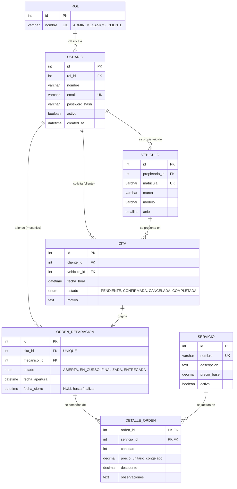

# Diagrama Entidad-Relación — GesTaller (Referencia Hito 2)

## 1. Diagrama (Mermaid)

**Lectura de cardinalidades**

- Un `ROL` tiene 0..N `USUARIO`; cada usuario tiene exactamente un rol.
- Una `CITA` origina como máximo una `ORDEN_REPARACION` (`||--o|`); una orden nace siempre de una cita.
- Una `ORDEN_REPARACION` tiene 1..N líneas (`||--|{`): no existe orden vacía.
- **Relación M:N** `ORDEN_REPARACION` ⟷ `SERVICIO`, resuelta con la tabla intermedia `DETALLE_ORDEN`.

## 2. Por qué `DETALLE_ORDEN` NO es una tabla pivote vacía

Una tabla con solo `(orden_id, servicio_id)` no representa negocio. Aquí la transacción vive en los atributos propios de la relación:

| Atributo                     | Razón de negocio                                                                 |
|------------------------------|----------------------------------------------------------------------------------|
| `cantidad`                   | Un servicio/pieza puede aplicarse N veces en una misma orden.                    |
| `precio_unitario_congelado`  | Copia del precio en el instante de la orden. Si `SERVICIO.precio_base` cambia mañana, las facturas históricas no se alteran. |
| `descuento`                  | Importe aplicado a esa línea concreta (0 ≤ descuento ≤ cantidad × precio).        |
| `observaciones`              | Notas del mecánico sobre esa intervención.                                       |

Clave primaria compuesta `(orden_id, servicio_id)`: un servicio aparece una vez por orden; si se repite, se incrementa `cantidad`.

## 3. Normalización

**1FN — Valores atómicos, sin grupos repetitivos.**
Cada columna guarda un único valor. No existe `servicios = "cambio aceite, frenos"` en la orden: los servicios son filas en `DETALLE_ORDEN`. `Vehiculo.marca` y `modelo` están separados, no concatenados.

**2FN — Sin dependencias parciales de la clave compuesta.**
Se cumple 1FN y, en `DETALLE_ORDEN` (clave `orden_id + servicio_id`), todos los atributos dependen de la clave **completa**: `cantidad`, `precio_unitario_congelado`, `descuento` y `observaciones` describen *ese servicio en esa orden*. El nombre o la descripción del servicio dependería solo de `servicio_id` (dependencia parcial), por eso viven en `SERVICIO`.

**3FN — Sin dependencias transitivas.**
Se cumple 2FN y ningún atributo no clave depende de otro no clave. Ejemplos: el nombre del rol no se guarda en `USUARIO` (dependería de `rol_id`); los datos del propietario no se repiten en `CITA` ni `VEHICULO` (se alcanzan por FK). El total de la orden **no se almacena**: se calcula como `SUM(cantidad * precio_unitario_congelado - descuento)`; guardarlo sería redundancia derivada.

> Nota: `precio_unitario_congelado` no viola 3FN. No es un duplicado derivable de `SERVICIO`, sino un **hecho histórico** distinto (el precio vigente en un instante).

## 4. Diccionario de datos

Convención: `PK` clave primaria, `FK` clave foránea, `UQ` único, `NN` NOT NULL.

### rol
| Columna | Tipo         | Restricciones |
|---------|--------------|---------------|
| id      | INT AI       | PK            |
| nombre  | VARCHAR(30)  | NN, UQ        |

### usuario
| Columna        | Tipo         | Restricciones                          |
|----------------|--------------|----------------------------------------|
| id             | INT AI       | PK                                     |
| rol_id         | INT          | NN, FK → rol.id                        |
| nombre         | VARCHAR(100) | NN                                     |
| email          | VARCHAR(150) | NN, UQ                                 |
| password_hash  | VARCHAR(255) | NN (hash bcrypt, nunca texto plano)    |
| activo         | BOOLEAN      | NN, DEFAULT TRUE                       |
| created_at     | DATETIME     | NN, DEFAULT CURRENT_TIMESTAMP          |

### vehiculo
| Columna         | Tipo        | Restricciones            |
|-----------------|-------------|--------------------------|
| id              | INT AI      | PK                       |
| propietario_id  | INT         | NN, FK → usuario.id      |
| matricula       | VARCHAR(10) | NN, UQ                   |
| marca           | VARCHAR(50) | NN                       |
| modelo          | VARCHAR(50) | NN                       |
| anio            | SMALLINT    | NULL, CHECK (anio ≥ 1950)|

### servicio
| Columna      | Tipo          | Restricciones               |
|--------------|---------------|-----------------------------|
| id           | INT AI        | PK                          |
| nombre       | VARCHAR(100)  | NN, UQ                      |
| descripcion  | TEXT          | NULL                        |
| precio_base  | DECIMAL(10,2) | NN, CHECK (≥ 0)             |
| activo       | BOOLEAN       | NN, DEFAULT TRUE            |

### cita
| Columna      | Tipo     | Restricciones                                                    |
|--------------|----------|------------------------------------------------------------------|
| id           | INT AI   | PK                                                               |
| cliente_id   | INT      | NN, FK → usuario.id                                              |
| vehiculo_id  | INT      | NN, FK → vehiculo.id                                             |
| fecha_hora   | DATETIME | NN                                                               |
| estado       | ENUM     | NN, DEFAULT 'PENDIENTE'                                          |
| motivo       | TEXT     | NULL                                                             |

### orden_reparacion
| Columna         | Tipo     | Restricciones                           |
|-----------------|----------|-----------------------------------------|
| id              | INT AI   | PK                                      |
| cita_id         | INT      | NN, UQ, FK → cita.id (relación 1:0..1)  |
| mecanico_id     | INT      | NN, FK → usuario.id                     |
| estado          | ENUM     | NN, DEFAULT 'ABIERTA'                   |
| fecha_apertura  | DATETIME | NN, DEFAULT CURRENT_TIMESTAMP           |
| fecha_cierre    | DATETIME | NULL                                    |

### detalle_orden
| Columna                    | Tipo          | Restricciones                                |
|----------------------------|---------------|----------------------------------------------|
| orden_id                   | INT           | PK, FK → orden_reparacion.id (ON DELETE CASCADE) |
| servicio_id                | INT           | PK, FK → servicio.id                         |
| cantidad                   | INT           | NN, CHECK (> 0)                              |
| precio_unitario_congelado  | DECIMAL(10,2) | NN, CHECK (≥ 0)                              |
| descuento                  | DECIMAL(10,2) | NN, DEFAULT 0, CHECK (≥ 0)                   |
| observaciones              | TEXT          | NULL                                         |
