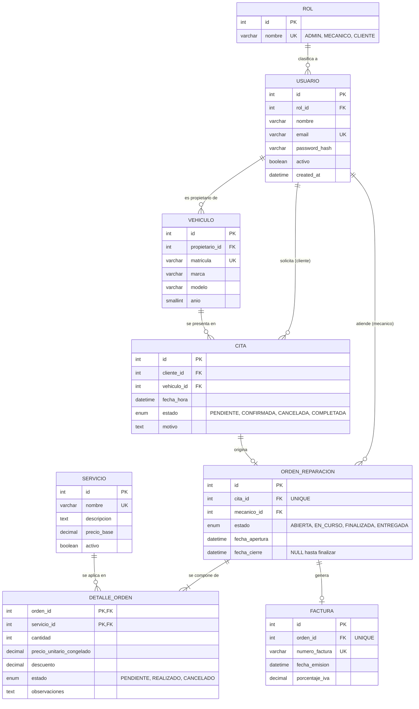

# Diagrama Entidad-Relación — GesTaller (referencia del Hito 2)

> **Cómo usar este documento.** Es el espejo de lo que el Hito 2 exige en `docs/der.md`: DER en Mermaid, relación M:N con atributos propios, justificación de la 3FN y diccionario de datos. Estudia el **razonamiento**; tu dominio, tus entidades y tus atributos deben ser los de **tu** proyecto. Un DER de taller en un proyecto de otro sector delata la copia.

## 1. Requisitos oficiales y dónde se cumplen

| Requisito (Hito 2, apartado 2.1)                                         | Cumplimiento en GesTaller                                                  |
|--------------------------------------------------------------------------|----------------------------------------------------------------------------|
| ≥ 5 tablas de negocio (**no cuentan** `usuario`, `rol`, tokens, sesiones) | 6: `vehiculo`, `servicio`, `cita`, `orden_reparacion`, `detalle_orden`, `factura` |
| Al menos una relación 1:N justificada                                     | `usuario` → `vehiculo`, `vehiculo` → `cita`, `usuario` → `cita`…           |
| Al menos una M:N con tabla intermedia **con atributos propios**           | `orden_reparacion` ⟷ `servicio` mediante `detalle_orden` (4 atributos propios) |
| Normalización 1FN, 2FN y 3FN justificada                                  | Apartados 4 y 5                                                            |
| DER en Mermaid con PK, FK, tipos y multiplicidad                          | Apartado 2                                                                 |
| Diccionario de datos                                                      | Apartado 7 (integrado en este archivo)                                     |

> Si prefieres un archivo separado, el enunciado admite `docs/diccionario_datos.md`. Elige **uno** y no dupliques la información.

## 2. Diagrama (Mermaid)



**Lectura de cardinalidades**

- Un `ROL` tiene 0..N `USUARIO`; cada usuario tiene exactamente un rol.
- Una `CITA` origina como máximo una `ORDEN_REPARACION` (`||--o|`); una orden nace siempre de una cita.
- Una `ORDEN_REPARACION` tiene 1..N líneas (`||--|{`): no existe una orden vacía.
- Una `ORDEN_REPARACION` genera como máximo una `FACTURA` (`||--o|`): se factura al finalizar.
- **Relación M:N** `ORDEN_REPARACION` ⟷ `SERVICIO`, resuelta con `DETALLE_ORDEN`.

## 3. Por qué `DETALLE_ORDEN` NO es una tabla pivote vacía

Una tabla con solo `(orden_id, servicio_id)` no representa negocio: son dos números pegados. Aquí la transacción vive en los atributos propios de la relación:

| Atributo                     | Razón de negocio                                                                 |
|------------------------------|----------------------------------------------------------------------------------|
| `cantidad`                   | Un servicio o pieza puede aplicarse N veces en una misma orden.                  |
| `precio_unitario_congelado`  | Precio **pactado** en el instante de la orden. Si `servicio.precio_base` cambia mañana, las órdenes históricas no se alteran. |
| `descuento`                  | Importe aplicado a esa línea concreta (0 ≤ descuento ≤ cantidad × precio).        |
| `estado`                     | Avance de esa intervención (`PENDIENTE`, `REALIZADO`, `CANCELADO`).               |
| `observaciones`              | Notas del mecánico sobre esa intervención.                                       |

Clave primaria compuesta `(orden_id, servicio_id)`: un servicio aparece una vez por orden; si se repite, se incrementa `cantidad`.

**Cómo encontrar tu M:N:** busca el verbo transaccional de tu negocio («reserva», «pide», «contrata»). Pregúntate *«¿qué hay que recordar sobre cada par?»*. Si la respuesta es «nada», no es una M:N de negocio.

## 4. Normalización tabla a tabla

**1FN — Valores atómicos y sin grupos repetitivos.** Cada columna guarda un único valor. No existe `servicios = "cambio aceite, frenos"` en la orden: los servicios son filas de `detalle_orden`. `vehiculo.marca` y `vehiculo.modelo` están separados, no concatenados.

**2FN — Sin dependencias parciales de la clave compuesta.** Solo `detalle_orden` tiene clave compuesta `(orden_id, servicio_id)`. Todos sus atributos (`cantidad`, `precio_unitario_congelado`, `descuento`, `estado`, `observaciones`) describen *ese servicio en esa orden*, es decir, dependen de la clave **completa**. El nombre o la descripción del servicio dependería solo de `servicio_id` (dependencia parcial), por eso viven en `servicio`.

**3FN — Sin dependencias transitivas.** Ningún atributo no clave depende de otro no clave. Ejemplos aplicados:

| Tabla         | Qué NO se almacena                          | Por qué (dependencia que se evita)                        |
|---------------|----------------------------------------------|-----------------------------------------------------------|
| `usuario`     | Nombre del rol                               | `rol_nombre` depende de `rol_id`, no de `usuario.id`      |
| `cita`        | Nombre/email del cliente                     | Dependen de `cliente_id`; se obtienen con un `JOIN`       |
| `cita`        | Marca/modelo del vehículo                    | Dependen de `vehiculo_id`                                 |
| `detalle_orden` | Nombre del servicio                        | Depende de `servicio_id` (clave parcial)                  |
| `orden_reparacion` | Total de la orden                       | **Campo calculado** (ver apartado 5)                      |

## 5. 📐 CÓMO JUSTIFICAR LA TERCERA FORMA NORMAL (3FN) EN TU PROYECTO

### 5.1. Dependencia funcional y dependencia transitiva

- **Dependencia funcional** `A → B`: conocido el valor de `A`, el valor de `B` queda determinado. Ejemplo: conocida la `matricula`, la `marca` queda determinada.
- **Dependencia transitiva**: `A → B` y `B → C`, de modo que `A → C` solo «a través» de `B`. En una tabla, `C` depende de la clave **por culpa de un atributo no clave**.

**Ejemplo malo** (viola 3FN) — tabla `orden_reparacion` con datos del cliente repetidos:

| id (PK) | cliente_id | cliente_nombre | cliente_email      | estado   |
|:-------:|:----------:|----------------|--------------------|----------|
| 101     | 7          | Ana García     | ana@example.org    | ABIERTA  |
| 102     | 7          | Ana García     | ana@example.org    | EN_CURSO |
| 103     | 7          | A. García      | ana@example.org    | ABIERTA  |

Aquí `id → cliente_id` y `cliente_id → cliente_nombre, cliente_email`, luego `id → cliente_nombre` es **transitiva**. Consecuencias (anomalías):

- **Actualización:** si Ana cambia de email, hay que modificarlo en N filas; si se olvida una, los datos se contradicen (la fila 103 ya tiene el nombre distinto).
- **Inserción:** no puedes registrar un cliente sin abrirle una orden.
- **Borrado:** al borrar su única orden, pierdes los datos del cliente.

**Solución:** `cliente_nombre` y `cliente_email` viven **una sola vez** en `usuario`, y la orden solo guarda `cliente_id` (o lo alcanza vía `cita`). Los datos se recuperan con un `JOIN`.

### 5.2. Los campos calculados nunca se persisten

Un **campo calculado** (o derivado) es aquel cuyo valor se puede obtener a partir de otros datos de la base de datos: el **total de la orden**, el **subtotal de una línea**, la edad a partir de la fecha de nacimiento, el número de citas de un cliente.

**Por qué no deben guardarse:**

1. **Redundancia con riesgo de incoherencia.** El mismo hecho existe en dos sitios. Ejemplo: una orden tiene dos líneas (2 × 30,00 € y 1 × 45,00 €); `total` guardado = 105,00 €. Alguien edita la cantidad de la primera línea a 3 y olvida actualizar el total: la base de datos afirma 105,00 € cuando la suma real es 135,00 €. **No hay forma de saber cuál es la verdad.**
2. **Obliga a mantener la coherencia a mano.** Cada `INSERT`, `UPDATE` y `DELETE` de una línea exigiría recalcular y guardar el total, y cada nuevo punto de entrada (un seeder, un script, otro endpoint) es una oportunidad de olvidarlo.
3. **Es una dependencia transitiva encubierta:** el total depende de otras columnas no clave (`cantidad`, `precio_unitario_congelado`, `descuento`), no de la clave de la orden.

**Cómo se obtiene en su lugar** (en una consulta o en el servicio, nunca en una columna):

```sql
-- Total de una orden: se calcula en el momento de consultarla
SELECT o.id,
       SUM(d.cantidad * d.precio_unitario_congelado - d.descuento) AS total
  FROM orden_reparacion o
  JOIN detalle_orden d ON d.orden_id = o.id
 WHERE o.id = ?
 GROUP BY o.id;
```

**Distingue «derivado» de «histórico».** `precio_unitario_congelado` **sí** se guarda aunque `servicio.precio_base` ya contiene un precio: no es un derivado (no puede recalcularse), es un **hecho histórico** distinto («el precio pactado ese día»). Pregunta de control: *«si borro este dato, ¿puedo reconstruirlo con exactitud a partir del resto de la base de datos?»* Si sí, es derivado y sobra; si no, es histórico y se guarda.

**Excepción posible y cómo documentarla.** Algunos documentos fiscales ya emitidos (una factura) deben quedar inmutables. Si decides guardar los importes de una factura por esa razón, o desnormalizas por rendimiento medido, **debe constar aquí de forma explícita** como *desnormalización consciente*, con su motivo y cómo se garantiza la coherencia. Sin esa justificación, un campo derivado persistido se califica como dependencia no resuelta en 3FN. En GesTaller se evita el problema: `factura` solo guarda `porcentaje_iva` (dato de entrada congelado) y sus totales se calculan.

> Si en el enunciado oficial ves atributos como `subtotal` o `total_calculado`, no los copies sin pensar: aplica la prueba de control anterior y, si los mantienes, justifica la desnormalización.

### 5.3. Plantilla para escribir **tu** justificación

Rellena una fila por tabla en tu `docs/der.md`, con tus palabras y tus ejemplos:

| Tabla | Clave | 1FN: ¿atómica? | 2FN: ¿clave compuesta y dependencias completas? | 3FN: ¿algún atributo no clave determina a otro? | Campos calculados evitados |
|-------|-------|----------------|-------------------------------------------------|--------------------------------------------------|----------------------------|
| `<tabla>` | `<PK>` | `<sí/no y por qué>` | `<no aplica / sí porque…>` | `<ninguno / se movió X a la tabla Y porque…>` | `<total, edad…>` |

**Comprobación final antes de entregar**

- [ ] Cada tabla tiene una clave primaria y ninguna columna contiene listas ni valores compuestos.
- [ ] En las tablas con clave compuesta, ningún atributo depende solo de una parte de la clave.
- [ ] Ningún dato de otra entidad (nombre, email, descripción…) está copiado en una tabla que solo tiene su FK.
- [ ] No hay columnas `total`, `subtotal`, `edad`, `num_*` que se puedan calcular; si las hay, están justificadas como desnormalización.
- [ ] Cada atributo congelado (precios) está justificado como **histórico**, no como derivado.

## 6. Integridad referencial e índices

### `ON DELETE`: la decisión debe estar razonada

| Clave foránea                          | Acción     | Justificación                                                            |
|----------------------------------------|------------|--------------------------------------------------------------------------|
| `detalle_orden.orden_id` → orden       | `CASCADE`  | La línea es **subordinada**: no tiene sentido sin su orden.              |
| `detalle_orden.servicio_id` → servicio | `RESTRICT` | Un servicio del catálogo con histórico no puede borrarse (se desactiva con `activo = FALSE`). |
| `orden_reparacion.cita_id` → cita      | `RESTRICT` | La orden conserva su origen; no se borra una cita con orden.             |
| `factura.orden_id` → orden             | `RESTRICT` | Un documento fiscal no desaparece al borrar la orden.                    |
| `cita.vehiculo_id`, `cita.cliente_id`, `vehiculo.propietario_id`, `usuario.rol_id`, `orden_reparacion.mecanico_id` | `RESTRICT` | Se protege el histórico; se prefiere el borrado lógico (`activo`). |

> Regla práctica: `CASCADE` **solo** en detalles subordinados; `RESTRICT` para catálogos y transacciones históricas.

### Índices justificados por las consultas frecuentes

| Índice                                 | Consulta que acelera                                  |
|----------------------------------------|-------------------------------------------------------|
| `cita (cliente_id, fecha_hora)`        | «Mis citas», ordenadas por fecha                      |
| `cita (fecha_hora)`                    | Agenda global de un día (administrador)               |
| `orden_reparacion (mecanico_id, estado)` | «Órdenes abiertas asignadas a mí»                   |
| `vehiculo (propietario_id)`            | «Mis vehículos» (las FK no se indexan solas en todos los motores) |

Las columnas `UNIQUE` (`email`, `matricula`, `numero_factura`…) ya crean su propio índice.

## 7. Diccionario de datos

Formato oficial del Hito 2. `PK` clave primaria · `FK` clave foránea · `UQ` único.

### rol
| Campo  | Tipo SQL     | Nulo | Clave | Valor por defecto | Restricciones / Reglas | Descripción funcional      |
|--------|--------------|:----:|:-----:|-------------------|------------------------|----------------------------|
| id     | INT UNSIGNED | NO   | PK    | AUTO_INCREMENT    | —                      | Identificador del rol      |
| nombre | VARCHAR(30)  | NO   | UQ    | —                 | UNIQUE                 | `ADMIN`, `MECANICO`, `CLIENTE` |

### usuario
| Campo         | Tipo SQL     | Nulo | Clave | Valor por defecto   | Restricciones / Reglas                  | Descripción funcional                 |
|---------------|--------------|:----:|:-----:|---------------------|-----------------------------------------|---------------------------------------|
| id            | INT UNSIGNED | NO   | PK    | AUTO_INCREMENT      | —                                       | Identificador del usuario             |
| rol_id        | INT UNSIGNED | NO   | FK    | —                   | → `rol(id)` ON DELETE RESTRICT          | Rol RBAC del usuario                  |
| nombre        | VARCHAR(100) | NO   | —     | —                   | —                                       | Nombre completo                       |
| email         | VARCHAR(150) | NO   | UQ    | —                   | UNIQUE; formato de email validado en servidor | Identificador de acceso         |
| password_hash | VARCHAR(255) | NO   | —     | —                   | Hash bcrypt (coste ≥ 10); nunca se devuelve por la API | Credencial protegida           |
| activo        | BOOLEAN      | NO   | —     | TRUE                | —                                       | Borrado lógico                        |
| created_at    | DATETIME     | NO   | —     | CURRENT_TIMESTAMP   | —                                       | Fecha de alta                         |

### vehiculo
| Campo          | Tipo SQL     | Nulo | Clave | Valor por defecto | Restricciones / Reglas                 | Descripción funcional          |
|----------------|--------------|:----:|:-----:|-------------------|----------------------------------------|--------------------------------|
| id             | INT UNSIGNED | NO   | PK    | AUTO_INCREMENT    | —                                      | Identificador del vehículo     |
| propietario_id | INT UNSIGNED | NO   | FK    | —                 | → `usuario(id)` ON DELETE RESTRICT     | Cliente propietario            |
| matricula      | VARCHAR(10)  | NO   | UQ    | —                 | UNIQUE                                 | Matrícula                      |
| marca          | VARCHAR(50)  | NO   | —     | —                 | —                                      | Marca                          |
| modelo         | VARCHAR(50)  | NO   | —     | —                 | —                                      | Modelo                         |
| anio           | SMALLINT     | SÍ   | —     | NULL              | CHECK (`anio` >= 1950)                 | Año de matriculación           |

### servicio
| Campo       | Tipo SQL      | Nulo | Clave | Valor por defecto | Restricciones / Reglas        | Descripción funcional           |
|-------------|---------------|:----:|:-----:|-------------------|-------------------------------|---------------------------------|
| id          | INT UNSIGNED  | NO   | PK    | AUTO_INCREMENT    | —                             | Identificador del servicio      |
| nombre      | VARCHAR(100)  | NO   | UQ    | —                 | UNIQUE                        | Nombre en el catálogo           |
| descripcion | TEXT          | SÍ   | —     | NULL              | —                             | Detalle del servicio            |
| precio_base | DECIMAL(10,2) | NO   | —     | —                 | CHECK (`precio_base` >= 0)    | Tarifa **vigente** (la histórica vive en `detalle_orden`) |
| activo      | BOOLEAN       | NO   | —     | TRUE              | —                             | Borrado lógico del catálogo     |

### cita
| Campo       | Tipo SQL     | Nulo | Clave | Valor por defecto | Restricciones / Reglas                             | Descripción funcional        |
|-------------|--------------|:----:|:-----:|-------------------|----------------------------------------------------|------------------------------|
| id          | INT UNSIGNED | NO   | PK    | AUTO_INCREMENT    | —                                                  | Identificador de la cita     |
| cliente_id  | INT UNSIGNED | NO   | FK    | —                 | → `usuario(id)` ON DELETE RESTRICT                 | Cliente que solicita         |
| vehiculo_id | INT UNSIGNED | NO   | FK    | —                 | → `vehiculo(id)` ON DELETE RESTRICT                | Vehículo que se presenta     |
| fecha_hora  | DATETIME     | NO   | —     | —                 | Fecha futura validada en servicio                  | Momento de la cita           |
| estado      | ENUM         | NO   | —     | 'PENDIENTE'       | CHECK en (`PENDIENTE`,`CONFIRMADA`,`CANCELADA`,`COMPLETADA`) | Estado de la reserva |
| motivo      | TEXT         | SÍ   | —     | NULL              | —                                                  | Descripción del problema     |

### orden_reparacion
| Campo          | Tipo SQL     | Nulo | Clave  | Valor por defecto | Restricciones / Reglas                                   | Descripción funcional         |
|----------------|--------------|:----:|:------:|-------------------|----------------------------------------------------------|-------------------------------|
| id             | INT UNSIGNED | NO   | PK     | AUTO_INCREMENT    | —                                                        | Identificador de la orden     |
| cita_id        | INT UNSIGNED | NO   | FK, UQ | —                 | → `cita(id)` ON DELETE RESTRICT; UNIQUE (relación 1:0..1) | Cita que origina la orden    |
| mecanico_id    | INT UNSIGNED | NO   | FK     | —                 | → `usuario(id)` ON DELETE RESTRICT                       | Mecánico asignado             |
| estado         | ENUM         | NO   | —      | 'ABIERTA'         | CHECK en (`ABIERTA`,`EN_CURSO`,`FINALIZADA`,`ENTREGADA`) | Estado de la reparación       |
| fecha_apertura | DATETIME     | NO   | —      | CURRENT_TIMESTAMP | —                                                        | Apertura                      |
| fecha_cierre   | DATETIME     | SÍ   | —      | NULL              | CHECK (`fecha_cierre` >= `fecha_apertura`)               | Cierre (NULL hasta finalizar) |

### detalle_orden
| Campo                     | Tipo SQL      | Nulo | Clave  | Valor por defecto | Restricciones / Reglas                              | Descripción funcional                       |
|---------------------------|---------------|:----:|:------:|-------------------|-----------------------------------------------------|---------------------------------------------|
| orden_id                  | INT UNSIGNED  | NO   | PK, FK | —                 | → `orden_reparacion(id)` ON DELETE CASCADE          | Orden cabecera                              |
| servicio_id               | INT UNSIGNED  | NO   | PK, FK | —                 | → `servicio(id)` ON DELETE RESTRICT                 | Servicio aplicado                           |
| cantidad                  | SMALLINT      | NO   | —      | 1                 | CHECK (`cantidad` > 0)                              | Unidades aplicadas                          |
| precio_unitario_congelado | DECIMAL(10,2) | NO   | —      | —                 | CHECK (`precio_unitario_congelado` >= 0)            | Precio pactado en el momento de la orden    |
| descuento                 | DECIMAL(10,2) | NO   | —      | 0.00              | CHECK (`descuento` >= 0)                            | Descuento de la línea (importe)             |
| estado                    | ENUM          | NO   | —      | 'PENDIENTE'       | CHECK en (`PENDIENTE`,`REALIZADO`,`CANCELADO`)      | Avance de la intervención                   |
| observaciones             | TEXT          | SÍ   | —      | NULL              | —                                                   | Notas del mecánico                          |

### factura
| Campo          | Tipo SQL     | Nulo | Clave  | Valor por defecto | Restricciones / Reglas                                | Descripción funcional                 |
|----------------|--------------|:----:|:------:|-------------------|-------------------------------------------------------|---------------------------------------|
| id             | INT UNSIGNED | NO   | PK     | AUTO_INCREMENT    | —                                                     | Identificador de la factura           |
| orden_id       | INT UNSIGNED | NO   | FK, UQ | —                 | → `orden_reparacion(id)` ON DELETE RESTRICT; UNIQUE   | Orden facturada (1:0..1)              |
| numero_factura | VARCHAR(20)  | NO   | UQ     | —                 | UNIQUE                                                | Numeración correlativa                |
| fecha_emision  | DATETIME     | NO   | —      | CURRENT_TIMESTAMP | —                                                     | Emisión                               |
| porcentaje_iva | DECIMAL(4,2) | NO   | —      | 21.00             | CHECK (`porcentaje_iva` BETWEEN 0 AND 100)            | IVA aplicado (dato congelado; los importes se calculan) |
